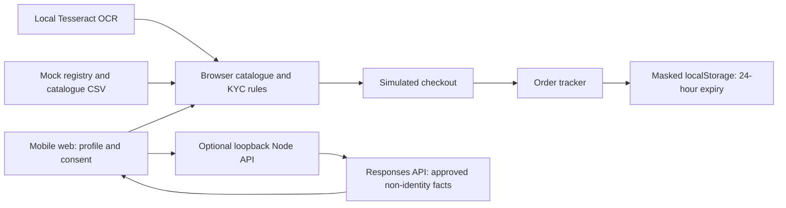

# Implemented architecture

All raw KYC stays in browser memory. Static hosting cannot run the Node API. Browser validation is not a production trust boundary. No production payment, CRM, registry or installation adapter exists. Production would require authenticated server decisions and approved document storage/retention.
